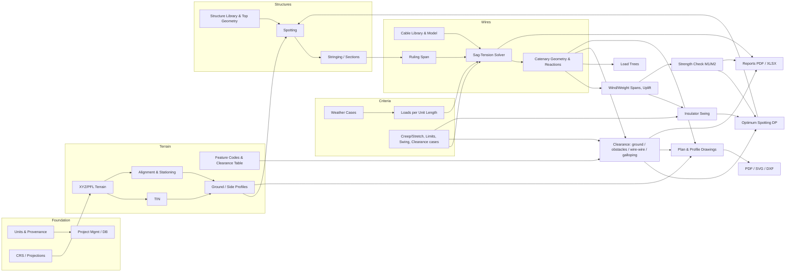

# TLCAD — Browser-Based Transmission Line Design Platform
## Pre-Development Plan (Deliverables 1–6)

*Working title "TLCAD" — rename freely. Prepared 2026-11-15 from the reference set in this folder.*

---

## 0. Reference set reviewed

| Document | Pages | Content value |
|---|---|---|
| `pls_cadd_pdf.pdf` — PLS-CADD **Version 12.3** User Manual (2012) | 488 | **Primary technical source.** Full engineering model: terrain, criteria, wind/ice, cables, structures, stringing/sagging, calculations, drafting, spotting, file formats, appendices A–R. |
| `PLS-CADD_Workflow.pdf` (PLS, 2021) | 19 | End-to-end project workflow flowchart (setup → terrain → criteria → structures → spotting → stringing → sagging → checks → P&P → reports). |
| `Plan & Profile - multialign.pdf` (manual v7 §6.3) | 9 | Alignment editing, multiple alignments, branches, loops, virtual-alignment rule for stringing. |
| `pdfcoffee…pls-cadd-4` (WAPCOS step-by-step) | 11 | Practical menu sequence; structure-family creation (DA/DB/DC/DD +0/+3/+6/+9 m), set/phase tables, angle-range assignment (0–3°, 3–15°, 15–30°, 30–60°). |
| `pdfcoffee…tutorial-pls-cadd-6` (Spanish tutorial) | 158 | Mostly screenshots. Useful: PI coordinate import from TXT, a complete **feature-code convention** (200 ground … 950 obstacles). |
| `ATUG_2022_PLS_CADD_WhatsNew.pdf` | 16 | Feature changes v16–17 (PLS-GRID, LAS/LAZ, design-rule check, performance). Context only — no formulas. |
| `pdfcoffee…google-earth` | 14 | KMZ export workflow (needs project CRS; vertical datum offset; tours). |
| `pdfcoffee…pls-cadd-amp-pls-pole` (ikeGPS) | 31 | Field data → PLS-POLE → PLS-CADD integration; staking-table import, feature-code spotting. Context only. |
| `Design_of_Transmission_Line_with_Use_of.pdf` (Kumar 2017) | 7 | Parabolic sag/low-point example at a rail crossing. **Arithmetic in the paper is internally inconsistent** — not usable as a validation case without correction. |

---

## 1. Manual Analysis — structured breakdown

### 1.1 Major functional modules identified (PLS-CADD menu → engineering function)

| PLS-CADD area | Manual § | Engineering function |
|---|---|---|
| File / Preferences / Backup | 5.1–5.3, App. K | Project container, units (US / SI-N / SI-daN), library paths, backup |
| Terrain | 6, App. C/D/E | XYZ & PFL models, feature codes, TIN, break lines, attachments (DXF/raster/SHP), CRS, side profiles, clearance lines, spotting constraints, equation stations |
| Terrain / Alignment | 6.3 | PI-based alignments, branches, loops, virtual alignment, MOPV/MOCGP widths |
| Criteria | 7 | Weather cases, code wind/terrain, creep/stretch, bimetallic model, cable tension limits, autosag limits, max-tension definition, weight span model, Method 1/2 conditions, structure load cases, survey-point clearance cases, phase clearance, galloping, insulator swing, W&W report cases |
| Structures | 8, App. F/P | Structure files (top geometry, sets/phases, insulators), strength Methods 1–4, parts/assemblies, spotting, moving, custom/site-specific |
| Sections (wires) | 9, 10.3, App. G | Cable files (mechanical model), stringing, sagging (tension / catenary / autosag / graphical), section table |
| Lines / Reports | 11, 12, App. R | Wind & weight spans, load trees, strength check, sag-tension, design limits, clearances (ground, wire-wire, galloping, structure, TIN), stringing charts, construction offsets, thermal rating, EMF, vegetation |
| Drafting | 13 | Plan & profile sheets, annotation, DXF/PDF export |
| Optimum spotting | 14 | Dynamic-programming least-cost spotting |
| PLS-CADD/LITE | 15 | Structure-centric model without terrain |

### 1.2 Engineering formulas extracted (implementable as documented)

**Wind & ice (§7.2)**
- Ref. pressure `P = Q·W²` (7-1); `Q = 0.6125` SI (Pa, m/s), `0.00256` US (psf, mph)
- Pressure at height `Pz = Q·Wz² = Kz·Q·W²` (7-2)
- Wire wind load `UH = WLF·Q·Wz²·GRFc·CDc·cos²(WA)·(D + 2tz)` (7-3)
- Structure wind force `WF = LFW·WLF·Q·Wz²·GRFs·CDs·A` (7-4/7-5)
- Ice load `UI = WLF·π·(D + tz)·tz·DENS + WICE` (7-6)
- Resultant `UR = √(UH² + (UW + UI)²)`; blowout `tan β = UH / (UW + UI)` (§7.2.3)
- NESC District: tensions from `UR_NESC = UR + K`; reactions V, T scaled by `UR/UR_NESC` (§7.2.3.1, 7.3.12.4)
- Effective heights: Level 1 = mean height of all attachment points in the tension section; per-span = mean of the two end attachments (§7.2.1.1.2–3)

**Cable mechanical model (§9.1, App. G)** — strain ε in **percent**, virtual stresses
- Initial curve `σ = k0 + k1ε + k2ε² + k3ε³ + k4ε⁴` (9-1)
- Composite: `σ = σO(ARO/AT) + σC(ARC/AT)`, outer poly `a0..a4` (9-3), core `b0..b4` (9-4)
- Creep (10-yr) curves: outer `c0..c4` (9-8), core `d0..d4` (9-9)
- Unloading/reloading slope = final modulus `EFO = (ARO/AT)·EF_outer` (9-5), `EFC` (9-6)
- Elastic simplification `σ = Eε` (9-10); creep `σ = −E·PC + Eε` (9-11)
- Thermal shift per material `ΔL/LREF = ET·(T − TREF)` (9-12)
- States: **Initial**, **Final after Creep** (permanent set PC at creep weather case stress), **Final after Load** (permanent set PCP at common-point weather case stress). Creep controls if PC > PCP.
- Aluminum in compression: none / limited / unlimited (§9.3.2, 7.3.5); GAP-type conductor shift (§9.2.2)
- Bundles: twisted pair (D = 1.64 d), lashed, bundled, spaced-messenger rules (§9.2.1)

**Catenary & span reactions (App. J)**
- `y = C·cosh(x/C)`, `C = H/UR` (J-1); `V = H·sinh(x/C)`, `T = H·cosh(x/C)` (J-2)
- Mid-span sag from chord `SAG = C(cosh(h'/2C) − 1)·√(1 + (v'/(2C·sinh(h'/2C)))²)` (J-3)
- Low-point location `a = h'/2 − C·asinh(v'/(2C·sinh(h'/2C)))` (J-7)
- End vertical force (local) `ZE` (J-9)
- Swung-out span reactions `VE = ZE cosβ + H sinα sinβ`, `TE = ZE sinβ − H sinα cosβ`, `LE = H cosα` (J-11…J-13)

**Ruling, wind, weight spans (App. I)**
- `RS = √( Σ(Si⁴/Ci) / ΣCi )` (I-1) — chord-corrected
- Wind span (Method 1/2 checks) = average of adjacent **chord** lengths
- Weight span: "arc length" option (vertical-plane catenary, arc length between low points) or "exact" option (`VS = VL/UV`, VL from App. J); `VS = VSL + VSR`, negative ⇒ uplift

**Structure loads (§7.3.12)**
- Factored span reactions `V* = LFV·NC·V`, `T* = LFW·NC·T`, `L* = LFT·NC·L` (7-7…7-12)
- Structure pressures `SPRT = LFW·WLF·Q·W²·cos(WB − SO)`, `SPRL = …sin(WB − SO)` (7-13/14)
- 10 wind-direction options (NA±, BI±, NL±, NR±, GLB, MAX), unbalanced-load commands (§7.3.12.7)

**Insulators (§7.3.16)**
- Suspension swing `SA = atan[(T + TINS/2)/(V + VCW + VINS/2)]` (7-37)
- 2-part load angle `LA = atan[(T + TINS)/(V + VCW + VINS)]` (7-38)
- Wind blown ⊥ to each adjacent span in both directions; 4 swing conditions with min/max limits

**Galloping ellipses (§7.3.15)** — REA single/double loop and CIGRE TB 322 (7-22…7-36)

**Clearance rules (§6.1.1, 11.2.3)** — rectangular zone (RH>0 → violation), band (RH=0 → "questionable"), radial (3-D, uses RV); aerial obstacles checked below; wind from left & right (optionally continuous); wire-wire 3-D minimum distance incl. diameters; ice-jump envelope rule.

**Structure strength (§8.3, App. F.1.4)** — Method 1 allowable HSmax, VSmax1–3, VSmin per line angle (linear interpolation); Method 2 polygon interaction diagrams per angle range & load case.

**Optimum spotting (§14.1)** — DP recurrence `C(i,j) = Pj + min_{k<i, l}[C(k,l) + F(N(k,l),i,j)]` (14-2), outer iteration on ruling span until assumed≈derived (≈5 %).

### 1.3 Data I/O formats documented

| Format | Status in manual |
|---|---|
| **XYZ** terrain (ASCII) | Fully specified (App. D.1): header + `'desc' X Y Z code h 'profNote' 'planNote'` |
| **PFL** terrain | Fully specified (App. E.1): `'desc' Station Offset Z LineAngle(sec) code h notes` |
| **BRK** break lines | Fully specified (App. D.6) |
| User-defined delimited import (CSV/TXT) | Behaviour specified (D.3: field mapping, unit, CRS, lat/long option) |
| LAS | Behaviour described (D.7 class→feature-code map); format is ASPRS public |
| DXF / SHP / raster attachments | Behaviour described (§6.6); formats are public |
| KMZ export | Workflow described (Google Earth note) |
| `.fea`, `.cri`, `.wir`, structure files, `.lca/.lic`, `.pps`, `.con`, `.prt` | **Not specified** — "ASCII but format not described" |

### 1.4 Missing information (will NOT be invented)

| # | Gap | Impact | Proposed handling |
|---|---|---|---|
| G1 | **Change-of-state solver algorithm** — the manual defines the cable constitutive model and states but not the numerical procedure that finds H for a new weather/cable state. | Core of sag-tension. | Implement the standard **strain/length-compatibility method** on the ruling span using the manual's model exactly. Flag as "method: standard length compatibility (not specified in manual)". Validate against independent hand calcs and any PLS-CADD/SAG10 output you can supply. |
| G2 | Cable coefficient data (a/b/c/d polynomials, EF, ET) for real conductors — the manual points to the powline.com library; Drake values appear only in a figure. | Need real cable files. | Cable editor + test-data regression (App. G.1 is documented). **Request:** your `.wir` files or manufacturer stress-strain data. |
| G3 | Code-specific Kz, gust response factor, drag (NESC, ASCE 74, IEC 60826, EN 50341, AS/NZS 7000) — deferred to external `version7_loads.pdf`. | Automated height/gust adjustment. | Manual GRFc / Kz input only (documented path). Code automation once you provide the code clauses. |
| G4 | Native PLS-CADD file formats (`.fea .cri .wir .str/.lca …`). | No direct interop. | Own JSON schema + documented XYZ/PFL/BRK interop. Revisit if you can share sample files. |
| G5 | Finite-element Levels 2–4 (SAPS) and Method 3/4 structure analysis (TOWER/PLS-POLE). | Advanced only. | Out of scope; Level 1 + Methods 1/2 implemented; load trees produced for external analysis. |
| G6 | Thermal rating (IEEE 738), EMF, construction offsets (Winkelman "long form"), improved linear cable model technote. | Secondary modules. | Marked "awaiting reference document". |
| G7 | Actual clearance values (NESC/IEC tables). | User data. | Feature-code clearance table is fully user-configurable; no defaults presented as code values. |

---

## 2. Feature Matrix

Complexity: **L** low · **M** medium · **H** high · **VH** very high. Doc = coverage in references (●full ◐partial ○none).

| ID | PLS-CADD function | Web equivalent | Doc | Cx | Depends on | Phase |
|---|---|---|---|---|---|---|
| P1 | New/Open/Save project, backup | Project manager, JSON project in browser DB, `.tlcad` zip export | ◐ | M | — | 1 |
| P2 | Preferences & unit systems | Unit service (SI internal, US/SI-N/SI-daN display) | ● | M | — | 1 |
| P3 | Revisions | Snapshot history with diff summary | ○ | M | P1 | 1 |
| P4 | Undo/redo | Command stack | ◐ | M | P1 | 1 |
| T1 | XYZ import/export | Parser/writer per App. D.1 | ● | L | P1 | 2 |
| T2 | PFL import/export | Parser/writer per App. E.1 | ● | L | A1 | 2 |
| T3 | User-defined CSV/TXT import with field mapping | Import wizard (delimiter, columns, units, CRS, lat/long) | ● | M | T1, A5 | 2 |
| T4 | DEM (GeoTIFF/ASCII grid) | Raster → XYZ sampling | ○ | M | T1, A5 | 2 |
| T5 | LAS/LAZ | loaders.gl + class→code map | ◐ | H | T1 | 2+ |
| T6 | Feature codes & clearance table | Editor (voltages ≤20, RV/RH, aerial, on-ground, symbols, labels) | ● | M | — | 2 |
| T7 | TIN | Delaunay (constrained by break lines later) | ◐ | M | T1 | 2 |
| T8 | Terrain edit (add/edit/delete/deactivate, filters) | Table + graphical | ● | M | T1 | 2 |
| T9 | Side profiles, clearance line & spikes | Profile overlays | ● | M | A3, T6 | 2/5 |
| T10 | Break lines | BRK I/O, constraints in TIN | ● | M | T7 | 2+ |
| T11 | DXF/SHP/raster attachments | Overlay layers | ◐ | H | A5 | 6 |
| A1 | Alignment PI add/insert/move/delete/reverse | Plan-view tools | ● | M | T1 | 2 |
| A2 | Multiple alignments, branches, loops, virtual profile | Alignment graph + ordering rule | ● | H | A1 | 2+ |
| A3 | Station/offset projection, MOPV/MOCGP profile | Geometry engine | ● | M | A1 | 2 |
| A4 | Equation stations | Station mapping | ● | L | A3 | 2 |
| A5 | CRS define/reproject | proj4js + WKT/PROJ string | ◐ | M | — | 2 |
| A6 | Map view | MapLibre basemap + alignment/structures | ○ | M | A5 | 2 |
| A7 | Delete small-angle PIs, auto-alignment via feature codes | Tools | ● | L | A1 | 2 |
| C1 | Cable library & editor | Cable data form (§9.2 fields) | ● | M | P2 | 3 |
| C2 | Nonlinear bimetallic model w/ creep | Engine `cable-model` | ● | H | C1 | 4 |
| C3 | Simplified linear model | Engine | ● | L | C1 | 4 |
| C4 | Coefficients from test data (regression) | Least-squares 4th-order fit | ● | M | C1 | 3 |
| C5 | Cable graphs (tension-elongation, creep, at temp) | Charts | ● | M | C2 | 4 |
| C6 | Bundles / GAP conductor | Cable/section options | ● | M | C2 | 4 |
| C7 | Improved linear model | — | ○ | — | — | gap G6 |
| S1 | Structure library, top geometry editor | Sets/phases, insulator types, offsets (App. F.1.1) | ● | M | P2 | 3 |
| S2 | 2-part (V-string) geometry | Point C solution (2 circle intersection) | ● | M | S1 | 3 |
| S3 | Method 1 strength (allowable spans) | Table + interpolation | ● | L | S1 | 3 |
| S4 | Method 2 interaction diagrams | Polygon containment | ● | M | S1 | 5 |
| S5 | Multiple-height families (batch save) | Family generator | ● | L | S1 | 3 |
| S6 | Structure 2D/3D display | Stick model from top geometry | ◐ | M | S1 | 3 |
| S7 | Parts/assemblies, BOM | Material tables | ● | M | S1 | 6 |
| S8 | Method 3 / Method 4 | — | ○/ext | — | — | gap G5 |
| SP1 | Manual spotting (add/move/snap/copy/N-paste) | Profile tools | ● | M | A3, S1 | 3 |
| SP2 | Angle structures at PIs / at feature codes | Auto tools | ● | M | SP1 | 3 |
| SP3 | Spotting constraints (prohibited, extra cost, required) | Constraint table & graphics | ● | M | A3 | 5 |
| SP4 | Optimum spotting (DP) | Worker-based DP + RS iteration | ● | VH | E1–E6, S3/S4, CL1, SP3 | 5 |
| W1 | Stringing (sets, attachments, bypass, transposition) | Stringing dialog | ● | M | SP1, C1 | 3 |
| W2 | Sagging by H / catenary constant | Section modify | ● | L | W1, E3 | 4 |
| W3 | Automatic sagging | Max-tension search vs autosag limits | ● | M | E3, E7 | 4 |
| W4 | Graphical sagging (drag / snap to point, RS) | Interactive | ● | M | E3 | 4 |
| W5 | Section table | Grid | ● | L | W1 | 4 |
| E1 | Weather cases & load per unit length | Engine `loads` (7-1…7-6, NESC K) | ● | M | P2 | 4 |
| E2 | Ruling span | (I-1) | ● | L | W1 | 4 |
| E3 | Sag-tension change of state, Initial/Creep/Load | Engine `sag-tension` | ◐ (G1) | H | C2, E1, E2 | 4 |
| E4 | Catenary geometry & reactions | (J-1…J-13) | ● | M | — | 4 |
| E5 | Wind & weight spans, uplift | App. I, both weight-span models | ● | M | E3, E4 | 4 |
| E6 | Insulator swing / 2-part load angle | (7-37/38) | ● | M | E5 | 4 |
| E7 | Cable tension limits & design check | §7.3.6, 11.2.2 | ● | L | E3 | 4 |
| E8 | Structure load trees | (7-7…7-14) + unbalanced cmds | ● | H | E4, E5 | 5 |
| E9 | Sag-tension report, stringing charts | Reports | ● | M | E3 | 4/6 |
| E10 | Max tension: RS vs actual geometry | §7.3.8 | ● | L | E4 | 4 |
| CL1 | Survey point clearances (rect/radial, wind L/R) | Engine `clearance` | ● | H | E3, T6 | 5 |
| CL2 | Clearance to TIN / isoclearance | 3-D distance to TIN | ◐ | H | T7, CL1 | 5+ |
| CL3 | Wire-to-wire clearance (incl. crossing lines, ice jump) | 3-D segment distance | ● | H | E3 | 5 |
| CL4 | Galloping ellipses | (7-22…7-36) | ● | M | E3 | 5 |
| CL5 | Wire-to-structure / departure angles | Needs structure solid model | ◐ | H | S6 | later |
| CL6 | Vegetation / danger tree | Point-based falling-tree check | ◐ | H | CL1 | later |
| D1 | P&P sheet layout (page, scales, sheets, title block) | SVG sheet generator | ◐ | H | A3, E3, T9 | 6 |
| D2 | Annotation (text, lines, arrows) | Sheet editor | ● | M | D1 | 6 |
| D3 | Export PDF / DXF / SVG | jsPDF+svg2pdf, DXF R12 writer | ◐ | M | D1 | 6 |
| R1 | Structure (staking) table, summary, W&W, clearances, sag-tension, BOM | Report engine → PDF/XLSX | ● | M | all | 6 |
| R2 | KMZ export | KML builder | ◐ | M | A5 | 6 |
| X1 | Thermal rating, EMF, construction offsets | — | ○ | — | — | gap G6 |
| X2 | FE Levels 2–4, PLS-CADD/LITE | — | ○/ext | — | — | gap G5 / later |

---

## 3. System Architecture

### 3.1 Technology decisions (with engineering rationale)

| Concern | Choice | Why (engineering requirement) |
|---|---|---|
| Language | **TypeScript (strict)** everywhere | One typed model shared by UI, engine, file I/O; units and provenance enforced by types. |
| Frontend | **React 18 + Vite** | Mature, fast HMR; component model suits dialogs/tables of a CAD app. |
| UI shell | Custom desktop CSS + **dockview** (dockable panels) | PLS-CADD-like MDI windows (tile/dock); avoids generic dashboard look. |
| State | **Zustand + Immer**, command pattern | Deterministic undo/redo; snapshots for revisions. |
| Engineering engine | **Pure TS package `@tlcad/engine`** — no DOM, runs in a **Web Worker** | PLS-CADD recalculates instantly; local math avoids network round-trips; worker keeps UI responsive during optimisation/clearance sweeps; independently unit-testable. |
| Plan/Profile views | **Canvas 2D** custom renderer (+ hit-testing) | 10⁵–10⁶ terrain points, pan/zoom at 60 fps; aspect-ratio exaggeration in profile. |
| Drawing sheets | **SVG** generation | Vector output feeds PDF, SVG and DXF exporters from one geometry source. |
| 3D | **Three.js** via @react-three/fiber | TIN mesh, catenaries, stick structures, markers. |
| Map | **MapLibre GL JS** | Geographic alignment display over basemap (online); plan canvas works offline. |
| CRS | **proj4js** + bundled EPSG subset + paste WKT/PROJ | Mirrors manual §6.2.1 (incl. PRJ/WKT path). |
| TIN | **Delaunator** (later constrained by break lines) | Robust, fast. |
| Storage | **SQLite (sqlite-wasm on OPFS)** in browser = centralized project DB; export/import `.tlcad` (zip of JSON + XYZ) | Real relational project DB with no server; files portable. |
| Exports | jsPDF + svg2pdf.js (PDF), own DXF R12 writer, ExcelJS (XLSX) | All client-side. |
| Testing | **Vitest** (engine), Playwright (UI smoke) | Validation suite is a first-class deliverable. |
| Backend | **Deferred: optional Python FastAPI service** | Not needed for Phases 1–6. Introduce only when a concrete need appears: very large LAS/LAZ (PDAL), GDAL-grade DEM reprojection, or multi-user server DB (PostgreSQL/PostGIS). The engine API is designed so a server adapter can be added without UI changes. |

### 3.2 Layered architecture

```
┌──────────────────────────────── Browser (desktop) ─────────────────────────────────┐
│  UI layer (React)                                                                    │
│   Menu/Toolbar · Project Explorer · Workspace views · Properties · Log · Status bar   │
│        │ commands                         ▲ selectors                                 │
│  Application layer                                                                    │
│   Command bus (undo/redo) · Project store (Zustand) · Feature-status registry         │
│        │ requests (typed messages)        ▲ results + calc traces                     │
│  Engine (Web Worker, pure TS)                                                         │
│   units · geometry/alignment · terrain/TIN · loads · cable-model · catenary ·         │
│   ruling-span · sag-tension · spans · insulators · structure-check · load-trees ·     │
│   clearance · galloping · spotting-DP · stringing-charts                              │
│        │                                                                              │
│  I/O layer: XYZ · PFL · BRK · CSV/TXT · GeoTIFF · LAS · DXF · KMZ · PDF · XLSX · JSON │
│  Persistence: sqlite-wasm (OPFS) ⇄ .tlcad archive                                      │
└──────────────────────────────────────────────────────────────────────────────────────┘
            (optional later) ⇄ FastAPI service: PDAL / GDAL / PostgreSQL+PostGIS
```

### 3.3 Repository layout (monorepo, pnpm workspaces)

```
tlcad/
  packages/
    engine/        # pure engineering library — no UI imports allowed
      src/units, geometry, terrain, loads, cable, catenary, sagtension,
          spans, insulators, structures, clearance, spotting, reports-data
      test/        # validation cases (manual examples + independent hand calcs)
    io/            # format parsers/writers (XYZ, PFL, BRK, CSV, DXF, KMZ, …)
    model/         # project schema (types + zod validation), provenance tags
  apps/web/        # React app (shell, views, dialogs, workers)
  docs/            # this plan, ADRs, calculation notes, validation reports
```

### 3.4 Core data model (summary)

`Project` → `{ meta, units, crs, featureCodes[], terrain{points, tin, breaklines}, alignments[], criteria{weatherCases[], creepStretch, tensionLimits[], autosagLimits[], weightSpanModel, clearanceCases[], swingConditions[], loadCases[]}, cableLibrary[], structureLibrary[], structures[] (placed instances), sections[] (strung sets), constraints[], drawings[], revisions[] }`

Every numeric engineering field is a `Quantity = { value (SI), source: 'user'|'imported'|'calculated'|'default', ref?: string }` so the UI can show **user / imported / calculated** distinctly and every result carries a **calculation trace** (inputs, equation refs e.g. "Eq. J-3", intermediate values, method, assumptions).

### 3.5 Engineering accuracy controls
- SI internally (as PLS-CADD does, §6.2.1); conversions only at UI/I/O boundaries.
- Input validation via zod schemas + engineering range checks (e.g. temperature, modulus, ε in %).
- **Feature-status registry**: every function declared `implemented | partial | planned | gap`, surfaced in *Help ▸ Feature Status* and next to commands; results from partial methods are labelled.
- No placeholder numbers: an unimplemented calculation returns a typed `NotImplemented` result, never a value.

---

## 4. Module Dependency Diagram



Critical path: **Units → Terrain/Alignment → Profile → Structures → Stringing → Cable model → Sag-tension → Catenary → Spans/Clearances → Drawings/Reports.**

---

## 5. Development Roadmap

Each phase ends with a runnable build, passing tests, and an updated Feature Status page.

| Phase | Deliverables | Acceptance criteria |
|---|---|---|
| **1 Foundation** | Monorepo, Vite/React shell with full menu bar (File…Help), toolbar, docked explorer/properties/log/status bar; project create/open/save/close; sqlite-wasm project DB; `.tlcad` export/import; revisions (snapshots); undo/redo; unit system & preferences; import/export framework (plugin registry); empty Plan (canvas), Profile (canvas), 3D (three.js) workspaces with pan/zoom/fit; Feature Status registry | Create → save → reload → export/import round-trip identical; undo/redo across ≥20 ops; unit switch re-renders all values; status page lists every matrix item |
| **2 Terrain & Alignment** | XYZ/PFL/BRK import-export (App. D/E); CSV/TXT mapping wizard; DEM GeoTIFF sampling; feature-code editor; TIN; terrain table edit; PI tools (add/insert/move/delete/reverse, small-angle delete); stationing/offsets/line angles; MOPV/MOCGP profile & side profiles; equation stations; CRS + MapLibre map view; 3D TIN | Manual's GRID example (13 pts, alignment 1-8-6) reproduces stations, line angles and profile; XYZ round-trip lossless; ≥200k points interactive |
| **3 Conductors & Structures** | Cable library/editor (all §9.2 fields, nonlinear + linear models, bundle data), coefficient regression from test points (App. G.1); structure library/editor (sets, phases, clamp/strain/suspension/post/2-part, offsets, min vertical load, swing limits, Method 1/2 strength tables, family batch-save); stick 2D/3D display; manual spotting (add/move/snap/copy/N-paste), angle-structure spotting at PIs/feature codes; stringing with sets/attachments/bypass/transposition | Structure placed on terrain gives correct global attachment XYZ (hand-checked); V-string point C matches 2-circle solution; regression reproduces input points within tolerance |
| **4 Engineering Calculations** | Loads (7-1…7-6, NESC K); cable states Initial/Creep/Load with bimetallic & compression options; change-of-state solver (G1, flagged); ruling span; catenary/sag/low point/arc length/reactions; sagging by H / C / autosag / graphical; wind & weight spans (both models), uplift; insulator swing; tension-limit check; sag-tension report & charts; comparison of load cases | Validation suite: closed-form catenary identities; elastic-linear change-of-state vs independent hand calc to <0.1 %; RS formula examples; weight-span sign/uplift cases; (if supplied) match to your PLS-CADD outputs |
| **5 Clearance & Design Analysis** | Survey-point clearances (rect/band/radial, aerial, wind L/R & sweep) with green/red/blue indicators; clearance line & spikes; wire-to-wire 3-D incl. crossing spans & ice-jump; galloping ellipses; Method 1/2 strength checks; load trees (7-7…7-14) & unbalanced commands; spotting constraints; optimum spotting DP with RS iteration | Clearance results for constructed test geometries match hand calcs; DP finds known optimum on synthetic profile; every violation listed in log with location link |
| **6 Drafting & Reporting** | P&P sheet layout (page size, scales, sheet split, title block), profile/plan bands, sag curves, clearance envelopes, structure labels, span/height dims, crossings, annotation editor; export PDF/SVG/DXF; reports: project info, structure/staking table, conductor schedule, span table, sag-tension tables, clearance results, spotting summary, criteria, warnings → PDF & XLSX; KMZ | DXF opens in AutoCAD/LibreCAD at correct scale; XLSX opens in Excel; sheets update live after model edit |
| **7 Integration & Testing** | End-to-end workflow test (import survey → alignment → criteria → spot → string → sag → check → sheets → reports); performance tuning; usability pass; validation report document | Full workflow on a sample line with no manual data fixes; validation report published |

---

## 6. Initial Interface Design

```
┌ File Edit View Project Terrain Structure Conductor Criteria Analysis Drafting Reports Help ┐
├─[New][Open][Save] │[Undo][Redo] │[Zoom][Pan][Fit][Init] │[Add PI][Move PI][Del PI] │[Add Str][Move Str] │[String][Sag] │[Clearance][Sag-Ten] ┤
├───────────────┬──────────────────────────────────────────────────────────┬──────────────────┤
│ PROJECT       │  ┌Plan─┐┌Profile─┐┌3D─┐┌Sag-Tension┐┌Structure┐┌Clearance┐ │ PROPERTIES       │
│ ▸ Terrain     │  │                                                    │ │ Structure #7     │
│   • Points    │  │   Active workspace view (dockable / tileable,      │ │ ─────────────    │
│   • TIN       │  │   multiple views side by side like PLS-CADD MDI)   │ │ Type  DA+3  [U]  │
│   • Feature   │  │                                                    │ │ Station 1+234.5  │
│ ▸ Alignments  │  │   Profile: ground line, side profiles, clearance   │ │ Height 33.0 m[C] │
│ ▸ Criteria    │  │   line + spikes, structures, phases at selected    │ │ Line ang 12°[C]  │
│ ▸ Cables      │  │   weather case, violation markers                  │ │ Wind sp 412 m[C] │
│ ▸ Structures  │  │                                                    │ │ Wt sp 380 m [C]  │
│ ▸ Sections    │  │                                                    │ │ [U]ser [I]mport  │
│ ▸ Drawings    │  └────────────────────────────────────────────────────┘ │ [C]alculated     │
│ ▸ Reports     │                                                         │                  │
├───────────────┴──────────────────────────────────────────────────────────┴──────────────────┤
│ LOG  [Results][Warnings 3][Errors 0][Calc trace]                                            │
│ ⚠ Span 6-7: vertical clearance 0.42 m below required (Road, 230 kV) @ Sta 2+105.3 [Go to] │
├─────────────────────────────────────────────────────────────────────────────────────────────┤
│ X 591549.81  Y 5318909.74 │ Sta 1+234.50 Off -2.1 │ Z 716.59 │ Tool: Move Structure │ Saved ✓│
└─────────────────────────────────────────────────────────────────────────────────────────────┘
```

**Design rules:** dense desktop CAD look (neutral greys, 12–13 px UI font, monospace numbers), modeless property editing, right-click context menus, keyboard shortcuts, every calculated value hoverable for its trace, colour code **green = compliant / red = violation / amber-blue = needs review** (mirrors the manual's red/blue convention).

**Workspace views**
1. **Plan** — terrain points/TIN contours, alignments & PIs, ROW, structures, wires (plan projection), attachments; optional MapLibre basemap mode.
2. **Profile** — virtual-alignment profile with aspect ratio, side profiles, clearance line, spikes, structures, wires per weather case, markers.
3. **3D** — TIN surface, structures, catenaries, blow-out, clearance markers.
4. **Sag-Tension** — section picker, weather/condition matrix, tension/sag table, tension-elongation & sag-temperature charts, case comparison.
5. **Structure Modeling** — top-geometry table + elevation/plan stick drawing, insulators, swing limits, strength tables.
6. **Clearance Analysis** — violation list, cross-section at point (manual Fig. 11.2-4c style), wire-wire and galloping results.

---

## 7. Open items needed from you
1. Approval of this architecture/roadmap.
2. **Project location** — the reference folder is a cloud-synced backup. A Node project creates ~100k files in `node_modules`; recommended location: a local, non-synced projects folder (docs can still be copied there).
3. **Git** is not installed — recommended for revisions/history (`winget install Git.Git`).
4. Any real cable files / conductor data (G2), a sample survey file, and — if available — PLS-CADD sag-tension reports to validate against.
